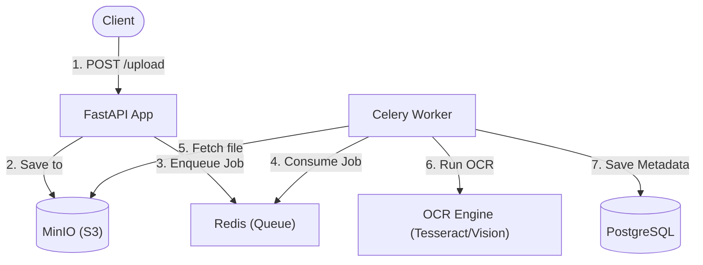
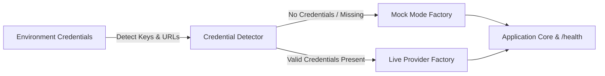

# Architecture — document-processor-ocr
> Last updated: 2026-08-29 | Maturity: Partial Prototype
> _OCR document processing with FastAPI and Celery._

## System Diagram

## Component Table
| Component | File | Responsibility | Tech |
|---|---|---|---|
| API | `api/` | Ingests documents | FastAPI |
| Worker | `doc_queue/` | Async processing | Celery |
| Storage | `storage/` | MinIO interface | Python |
| Database | `docker-compose.yml`| RDBMS for states | PostgreSQL |

## Dependency Honesty Table
| Dependency | Status | Notes |
|---|---|---|
| Postgres | **Real** | Used for metadata and job status. |
| MinIO | **Real** | Used as S3-compatible storage. |
| OCR Engine | **Mocked** | Simulated with a fixture for fast CI execution. |

## Progressive Credential Loading & Production Architecture (v0.2.0)

This service implements the **Progressive Credential Loading (PCL)** pattern, decoupling development speed from external infrastructure provisioning:

### Core Architecture Components
1. **Mode Detection Singleton:** Inspects environment configuration at boot time without hard crashes on missing secrets.
2. **Dual-Mode Factory Wrappers:**
   - **Storage / Cache:** In-process maps or SQLite `:memory:` transparently promote to managed Redis or PostgreSQL when connection strings are supplied.
   - **AI Providers:** Deterministic heuristic generators and local embeddings transparently promote to live OpenAI, Anthropic, or Gemini API clients.
3. **Hot-Reload & Dynamic TLS:** File watchers monitor mounted volume paths (Kubernetes ConfigMaps and Secrets) to update certificates and limit configs atomically without process restarts.
4. **Health & Observability:** The `/health` endpoint exposes real-time runtime mode metadata (`mock` vs `live`) across all backing adapters.
